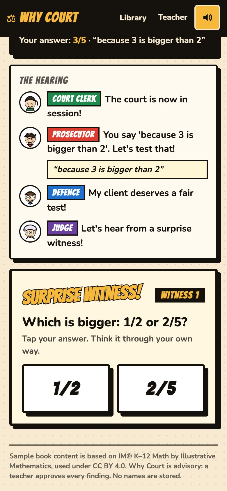
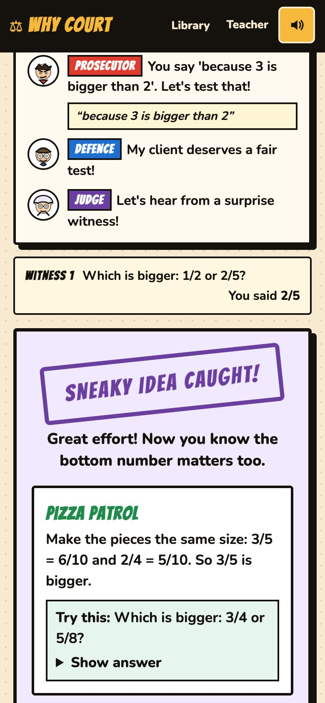
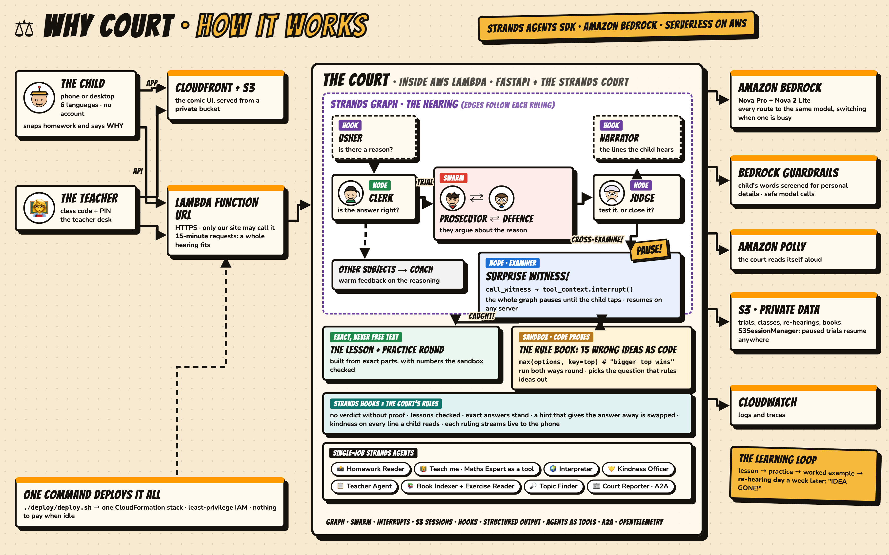
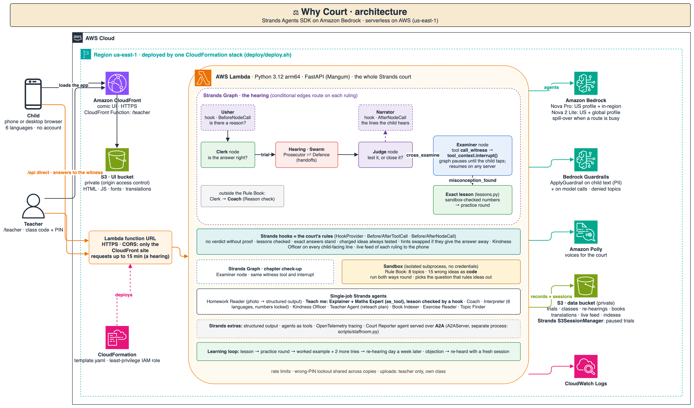
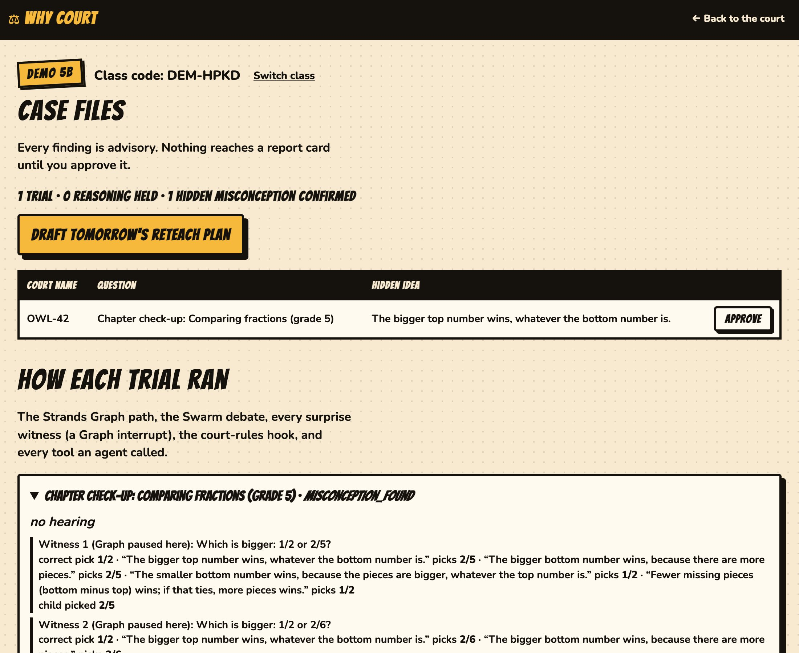

# Why Court

**A child gets the answer right. Why Court puts the *reason* on trial.**

A child's right answer can hide a wrong idea that happened to work this time ("3/5 is bigger than 2/4 *because 3 is
bigger than 2*"). Why Court is a comic-book courtroom, built with the [Strands Agents SDK](https://strandsagents.com)
on Amazon Nova, that finds that idea, **proves** it with the child's own answers, teaches the right one, and checks a
week later that it is gone. It never solves homework for a child: it only ever asks *why*.

<p align="center">
  
  
</p>

---

## The problem

A right answer is the weakest evidence a teacher has. Ask a 10-year-old which is bigger, 3/5 or 2/4, and "3/5" earns
a tick. Ask *why* and you may hear *"because 3 is bigger than 2"*: a rule that gives the right answer here and the
wrong one on 1/3 versus 1/4. The tick hides it. It surfaces two years later as "bad at fractions". Marking is built
around answers because reasons do not scale: thirty children, thirty explanations, no time.

## What it does

**For a child** (phone first, in their own language, read aloud):

- **Bring your homework**: snap it, type it, or say it. Nova reads each question, the answer and the child's reason.
- **Any question**: snap it, type it or say it, answered or not. Asked "Is a tomato a fruit or a vegetable?", the
  court replies "Good question! What do you think, and why?": it never just hands over an answer.
- **The trial**: a Prosecutor and a Defence argue about the reason; if there is a charge, **surprise witnesses**,
  questions chosen so that only the child's real thinking can answer them, with fraction bars and decimal grids to see.
- **Every result teaches something**: "You were thinking: *the bigger top number always wins*" and one thing to
  remember; a worked example with exact numbers; an insight card ("what the court learned about your thinking"); a
  wrong answer gets "Not quite yet", a hint, *Try again* and *Teach me*; a question the court cannot test gets honest
  Reason-check feedback (what you did well, what to think about, a next question).
- **Chapter check-up**: pick your grade and a chapter of your textbook; the court finds a sneaky idea *before* it
  costs marks.
- **Practice round**: three questions on which the old idea gives the wrong answer, with an exact reason after each.
- **Re-hearing day**: a week later, two fresh questions check whether the idea is gone.
- **Six languages** (English, Hindi, Tamil, Spanish, French, Swahili) and **Amazon Polly voices** for every character.

**For a teacher**: a class code to put on the board (children never need an account), a desk locked with a PIN that
shows only that class, a case file for every trial, findings to approve, a **learning check** ("4 of 5 caught ideas
were gone at re-hearing"), and a Court Reporter agent their own assistant can ask over **A2A**.

## The design in one sentence

**Agents read, argue, choose and teach; code proves; hooks enforce the court's rules.**

Language models are good at reading a child's words, choosing which known wrong ideas fit them, arguing, and
explaining. They are not reliable at inventing, on the spot, the exact rule inside a child's head and a question that
tells it apart from the truth: we measured that (0 to 1 of 5 hidden ideas caught). So every wrong idea is **executable
code**, every prediction is **run** in a sandbox, every number fact is **exact arithmetic**, and the court's fairness
rules are **Strands hooks** that agents cannot talk their way around.

## Architecture

<p align="center"></p>

The same architecture in detail:

<p align="center"></p>

Editable source: [`docs/architecture.drawio`](docs/architecture.drawio) (open it in draw.io / diagrams.net).

```
 Child (phone) / Teacher ─► FastAPI + comic UI · Polly voices · class codes + PIN · six languages
                                │
 TRIAL GRAPH (Strands Graph, one run per trial, paused for the child)
   [Usher hook] ─► Clerk ─► HEARING (Swarm: Prosecutor ⇄ Defence) ─► Judge ─► [Narrator hook] ─► Examiner ─► Tutor
     sees only        is the                                            sees only the decisions      │  ▲          │
     the reason       answer right?                                     and the child's words        │  │ interrupt│ asks the Maths
                                                                                                     ▼  │          │ Expert (as_tool)
                                                                        call_witness: one tool call runs the witness stand,
                                                                        pausing the Graph for every answer (Strands interrupts)
   outside the Rule Book: Clerk ─► Coach (Reason check, in seconds; no witness can be checked exactly yet)
   experimental (WHYCOURT_WITNESS_BUILDER=on): Judge ─► Witness Builder (Verifier via as_tool) ─► Examiner

 CHECK-UP GRAPH     Examiner at the same witness stand (topic from the chapter, or the Topic Finder agent)
 HOOKS              CourtRules on every agent · CourtOfficers + Timekeeper on the Graph
 TOOLS (exact)      calculate · act_out (sandbox) · call_witness · record_ruling (typed per role) · record_reteach
 SESSIONS           FileSessionManager locally, S3SessionManager in the cloud: a paused trial resumes anywhere
 A2A                Court Reporter (A2AServer, one class) ◄── a teacher's assistant (Strands make_a2a_client)
 AWS                Bedrock (Nova Pro, Nova 2 Lite) · Bedrock Guardrails · Polly · S3 · CloudWatch (OpenTelemetry)
```

| Strands feature | Where | Why that construct |
|---|---|---|
| **Graph** | The trial and the check-up | A trial is a fixed procedure with conditional branches; edges only read the rulings agents filed |
| **Swarm** | The hearing | The Prosecutor charges and hands the floor to the Defence, who answers (a two-agent debate) |
| **Interrupts** | `call_witness` | One tool call runs the whole witness stand, pausing the Graph for each of the child's answers |
| **Session manager** | Every trial and check-up | A paused trial survives a restart (verified live); S3 in the cloud |
| **Hooks** | `CourtRules`, `CourtOfficers`, `Timekeeper` | Court rules written once, in code: see below |
| **Agents as tools** | Maths Expert (for the Tutor), Verifier (for the Witness Builder) | An independent expert consulted mid-task |
| **Structured output** | Homework reading, the Narrator's lines, the simulated student's answers | Typed, checkable results |
| **A2A** | Court Reporter + teacher's assistant | Another agent can use the court without sharing code or data |
| **OpenTelemetry** | `WHYCOURT_TRACE=console\|otlp` | Every agent, model call, tool call and node as a span |

### The court's rules (Strands hooks), each written after a measured failure

| Rule | What happened before it |
|---|---|
| **No guilty verdict without proof**: the Examiner's verdict is rewritten to "not proven" unless the answers prove it | A model would call a child guilty on a hunch |
| **No verdict before the court has heard enough** | An Examiner ruled after one witness, so a provable idea went unproven |
| **A charge is never closed untested** (a Defence example cannot close a Rule Book charge) | The Judge closed charged cases in most runs; one lucky example is how a wrong idea hides |
| **Look-alikes are ruled out before an idea is named** | A child who *added* top and bottom was labelled "bigger top number wins": wherever that idea is wrong, adding is wrong the same way |
| **No lesson until the Maths Expert has read the exact text** | A Tutor showed the expert one draft and filed another, with a false reason |
| **Kindness** on every line a child reads; **the Usher** sees only the reason; **the Narrator** sees only decisions | A helpful Clerk once told the child the very thing the witness was about to test |
| **An exactly checkable answer cannot be marked wrong** (the Clerk is overruled by arithmetic) | A Clerk whose own calculator said "3/5 > 2/4 is True" filed *wrong answer* for 3/5 |
| **An objection cannot undo a proven idea by repeating it** | An objection restating "the top number is bigger" ended "Your reasoning holds up" |
| **No praise for the reason before the verdict** (Defence and Narrator stand by the child, not the idea) | The Defence called "the bigger top number wins" "real imagination" |

### Every agent and why it is separate

| Agent | Strands construct | Its one job | Why separate |
|---|---|---|---|
| Usher | Graph hook (before the Clerk) | Is there a reason at all? | Sees only the reason, so "is there a reason" is never "is it a good reason" |
| Clerk | Graph node | Is the answer right? | Judges the answer only |
| Prosecutor, Defence | Swarm | Charge and answer it, choosing suspects from the Rule Book | Two sides of a real argument |
| Judge | Graph node | Test it, or close it? | Decides after hearing both |
| Narrator | Graph hook (after the Judge) | The lines the child hears | Never sees the analysis, so it cannot spoil the witness |
| Examiner | Graph node | Runs the witness stand, gives the verdict | The only agent that talks to the child mid-trial |
| Tutor + Expert | Graph node + `as_tool` | A lesson outside the Rule Book, then an independent check | The checker must not be the writer. Inside the Rule Book the lesson is built from exact parts (`lessons.py`), never free text |
| Explainer + Expert | Strands Agent + `as_tool` | *Teach me* after a wrong answer, starting from the child's own reason | Outside the Rule Book; inside it, the exact worked answer |
| Coach | Strands Agent (structured output) | Reason-check feedback when the court cannot run a witness | Honest feedback instead of a silent "case closed" |
| Witness Builder + Verifier | Graph node + `as_tool` | Questions outside the Rule Book (experimental, off by default: `WHYCOURT_WITNESS_BUILDER=on`) | An auditor independent of the author |
| Homework Reader, Topic Finder, Interpreter, Kindness Officer, Teacher Agent, Book Indexer, Exercise Reader | Strands Agents with one job each | Reading, routing, translating, safety, class summaries, textbooks | Narrow prompts and narrow views |
| Court Reporter | `A2AServer` | One class's findings, counts only | Serves other agents across processes |

### How the witness questions are chosen: elimination, not guessing

1. **The Prosecutor chooses suspects from a Rule Book** of known wrong ideas from misconception research
   (fractions, decimals, negative numbers, multiplying and dividing, what floats, *a*/*an*, plurals, past tense).
   Choosing is easy for a model; inventing was not. Science and English use small item banks whose facts are known.
2. Each idea is **real code**, run in a sandbox. A suspect is dropped if it does not reproduce the child's answer.
3. **Each witness is the question that best splits the ideas still in play**; the child's answers eliminate them.
4. **An idea is named only when it is the last one standing, the child followed it on two questions where it
   disagrees with correct understanding, and its look-alikes are ruled out.** A child who understands may slip once;
   a wrong idea may not.

```python
def pick(question, options):
    return max(options, key=top)     # "the bigger top number wins", run, never imagined
```

## Safety

Children are the users, so safety is layered and none of it is decorative:

- **Amazon Bedrock Guardrails on Nova calls** — content filters, prompt-attack filter, profanity, and a
  denied topic that stops any agent asking a child for personal details. Created by
  `scripts/create_guardrail.py`. One exception, found in testing: the Swarm adds its own coordination text to
  each debater's input, which the prompt-attack filter flags, so the Prosecutor and Defence skip the per-call
  guardrail. They never see unscreened child text and never speak to the child directly.
- **Child text is screened before any agent reads it** (`ApplyGuardrail`), masking names, emails, phones.
- **The Kindness Officer** reads every line a child sees and rewrites anything that shames or labels.
  "Innocent until proven guilty" is enforced in code: no guilty verdict without proof.
- **The sandbox** that runs rule code gets an empty environment (no AWS credentials), a per-call alarm a rule cannot
  swallow, memory and CPU limits, and an AST allow-list (no imports, no `try`, no dunder or `.format` tricks).
- **Classes**: the teacher desk opens only with the class code and PIN (sent in headers, 5 wrong tries lock it for
  10 minutes); the A2A Court Reporter serves one class and shares counts only.
- **Limits**: every endpoint that spends on AWS is rate-limited per visitor; uploads are size-capped. The child's
  screen receives an allow-list of fields, never an answer key.
- **A found misconception is framed as a win**, never a failure.
- **Advisory only.** A teacher approves or rejects every finding on the Teacher Desk; nothing is automatic.
- **No names.** Each child gets a secret court name (like `LION-82`), made on their own device; a teacher can
  hand out their own codes instead. No names, voices or photos are stored.

<p align="center"></p>

## Results

Measured with simulated students across 12 cases, each privately given a wrong belief or told to reason correctly;
the court never sees the belief.

| Measure | Result |
|---|---|
| Hidden wrong ideas caught, the *right* idea named | **4 of 5** |
| Children with sound reasoning wrongly accused | **0 of 5** |
| A wrong idea named | **0** |
| Children outside the Rule Book given a label | **0 of 2** (correctly "not proven") |
| Hearing errors or timeouts | **0** |

## Run it

```bash
pip install -r requirements.txt

python scripts/create_guardrail.py         # one time; prints the two env vars to export
export WHYCOURT_GUARDRAIL_ID=... WHYCOURT_GUARDRAIL_VERSION=1

uvicorn app.server:app --reload            # http://localhost:8000  ·  teacher desk at /teacher
uvicorn app.server:app --host 0.0.0.0      # open it on a phone on the same Wi-Fi: http://<laptop IP>:8000

python scripts/staffroom.py serve CODE PIN # one class's Court Reporter over A2A on :9000
python scripts/staffroom.py ask "What should I reteach tomorrow?"   # a teacher's assistant agent asks it
```

Requires AWS credentials with Amazon Bedrock access in `us-east-1`. Only Amazon Nova models are used.

| Environment variable | Default | What it does |
|---|---|---|
| `WHYCOURT_GUARDRAIL_ID` / `_VERSION` | — | Bedrock guardrail applied to every call |
| `WHYCOURT_LITE_MODEL` / `_PRO_MODEL` | `us.amazon.nova-2-lite-v1:0` / `us.amazon.nova-pro-v1:0` | Model per tier |
| `WHYCOURT_MODEL_<AGENT>` | — | Override one role, e.g. `WHYCOURT_MODEL_WITNESS_BUILDER` |
| `WHYCOURT_KINDNESS` | `on` | `off` skips the Kindness Officer |
| `WHYCOURT_NODE_TIMEOUT` / `_TRIAL_TIMEOUT` | `120` / `600` | Seconds per step / per trial |
| `WHYCOURT_DATA` / `WHYCOURT_BOOKS` / `WHYCOURT_SESSIONS` | `data/` | Trials, uploaded textbooks, paused-trial sessions |
| `WHYCOURT_TRACE` | — | `console` or `otlp`: OpenTelemetry spans for every agent, tool and node |
| `WHYCOURT_REHEAR_DAYS` | `7` | Days until re-hearing day (`0` for a demo) |
| `WHYCOURT_SESSION_BUCKET` | — | Keep paused trials in S3 (Strands `S3SessionManager`) instead of local files |

## Deploy on AWS

**Live:** https://d3vzocttlteyn9.cloudfront.net/ (teacher desk at `/teacher`)

It runs serverless, in one command and with no Docker:

```
WHYCOURT_GUARDRAIL_ID=<your guardrail> ./deploy/deploy.sh
```

`deploy/template.yaml` (CloudFormation) creates:

```
 phone / browser ─► CloudFront ─► S3 (private, origin access control): the comic UI — HTML, script, fonts
       │
       └─ /api ───► Lambda function URL (HTTPS, CORS: only the CloudFront site, up to 15 min per request)
                      └─ Lambda, Python 3.12 arm64: FastAPI + the whole Strands court (Graph, Swarm, interrupts, hooks)
                           ├─► Amazon Bedrock: Nova Pro / Nova 2 Lite, the Guardrail · Amazon Polly
                           └─► S3 (private): trials, classes, re-hearings, uploaded books (one object each)
                                             + paused trials as Strands S3SessionManager sessions
```

- **Any copy of the function can resume any trial.** A paused Graph lives in S3 (`S3SessionManager`), so the child's
  next answer can land on a different Lambda instance.
- **Least privilege.** The role can call only the Nova models, this one Guardrail and Polly, and touch only its own bucket.
- **The UI is static, on S3 + CloudFront**, so a page load never wakes Lambda. The deploy script writes the API's
  address into `static/config.js`; locally it is empty and the same server serves both.
- **The browser calls the API at the function URL, not through CloudFront.** A hearing can run past one minute;
  CloudFront waits at most 60 s for an origin (30 s by default) and API Gateway 29 s; a function URL up to 15 minutes. CORS on the
  function URL lets only the CloudFront site call it from a browser.
- **Costs nothing when idle** beyond storage. Every endpoint that calls a model is rate-limited per visitor, and the
  account's Lambda concurrency caps the spend.
- **Remove it:** empty the data and UI buckets, then `aws cloudformation delete-stack --stack-name why-court`.

At school scale, the court can move onto AgentCore Runtime:

```
 CloudFront ─► S3 (the comic UI)
     └─────► Lambda (quick API: classes, uploads, Polly, practice, re-hearing) ─► DynamoDB (trials, classes)
                  └─► Amazon Bedrock AgentCore Runtime: the Strands court, one session per trial
                         └─ S3 (paused trials, S3SessionManager) · CloudWatch (OpenTelemetry traces)
     Court Reporter ─► a second AgentCore Runtime (A2A)
```

## Known limits and what comes next

- **Proof needs a checkable answer.** Eight topics have a Rule Book today. Any question gets a hearing and a lesson,
  but the court only claims proof where it can check the answer exactly; open questions ("why did the war start?")
  never get a "proven" label: they get honest Reason-check feedback. The Witness Builder for other topics is
  experimental and off by default (measured: 60-90 s of waiting, rarely a fair question).
- **Next: a Rule Book that grows itself.** A Rule Writer agent proposes wrong ideas as code (researching common
  misconceptions from trusted sources, with citations), the sandbox and the Verifier check them, and a teacher
  approves them before the court may use them. The hand-written book is the seed, not the limit.
- **A trial takes about a minute**, many Nova calls in sequence. Streaming each line to the screen as it is ready
  (Strands streaming) is the next UX step.
- **Storage** is JSON files on one server, or one S3 object per record when deployed. Listing a whole class
  reads every record, which is fine for a classroom; DynamoDB is the next step at school scale. The double-tap guard
  (one answer at a time per trial) works within one Lambda instance only.
- **Uploading a whole textbook PDF** works on a local server; on Lambda a request is capped at 6 MB, so only small
  PDFs upload there. Teachers use a class code and PIN; Cognito or AgentCore Identity would give them real sign-in.
- **Translations** for Tamil and Swahili have not been reviewed by a native speaker; Polly has no voice for them.
- **Ages**: built for 8-14. A 15-year-old gets real feedback on any reason but proof only in the 8 topics; a child who
  cannot read yet cannot use it (a voice-first mode would be a different product).
- **How we test the experience**: an independent agent plays children of different ages and a teacher, presses every
  button on a clean copy, and reports what fails. Its first report found the court praising a caught idea, a lesson
  stating it as the rule, and dead ends; all of those are fixed above and re-audited.
- **Evaluation** uses simulated students on a small seed set; the figures are indicative, not a study.

## The Law Library

A school can drop in its own textbook PDF: a `book_indexer` agent reads the table of contents, an
`exercise_reader` agent pulls out each chapter's key rules and exercises, and the court then judges by *that*
book. Uploaded books stay on the school's own server and are never redistributed.

The bundled sample book contains real problems from a CC BY-licensed curriculum (see Credits).

## Tech

Strands Agents SDK 1.63 (Graph, Swarm, interrupts, hooks, session manager, agents as tools, A2A, OpenTelemetry) ·
Amazon Bedrock (Nova Pro, Nova 2 Lite) · Bedrock Guardrails · Amazon Polly · FastAPI · no
front-end framework, no build step — one HTML file, one stylesheet, one script.

## Credits and licence

Why Court is MIT licensed — see [LICENSE](LICENSE).

- Sample book content in `books/open-maths-4-6.json` is based on **IM® K–12 Math**, authored by
  Illustrative Mathematics, licensed under **CC BY 4.0**. Problems were split into single parts, diagram-only
  problems were omitted, and answers and chapter summaries were written by Why Court. IM® is a registered
  trademark of Illustrative Mathematics; this project is not affiliated with or endorsed by them.
- Fonts bundled in `web/fonts/` — **Bangers** and **Nunito**, SIL Open Font License 1.1 (licences included).
- Character art is original SVG drawn in `web/app.js`.
